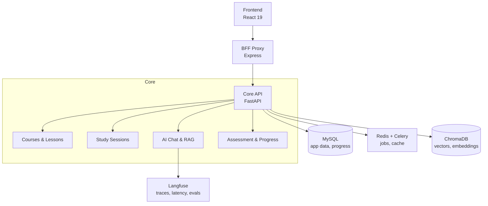

## Summary

An AI learning platform built as a monorepo. The frontend, backend, and QA tooling live in one repository so API and UI changes ship together. It was the final project of the AI-Enabled Python Web Dev program at Devscale.

## Context and constraints

AI features cannot run on a normal request path. Document chunking, embedding, and model calls take seconds, so that work has to leave the request and response cycle. Answer quality is also hard to judge after release without a trail, so observability was built in from the start rather than added later.

## Architecture

The browser calls an Express BFF proxy, which forwards to the FastAPI core. The core API owns all domain logic: courses, study sessions, AI chat with retrieval, and assessment. Slow AI work (embedding, generation) is dispatched to Celery workers via Redis. Vector search runs against ChromaDB. Langfuse captures every LLM call, latency, and evaluation so the team can trace regressions after release.

## Features

**Adaptive learning paths.** Courses and lessons adapt based on student progress and assessment results.

**Study sessions with AI assistance.** Students chat with an AI tutor that retrieves relevant context from the course material using RAG (Chonkie for chunking, ChromaDB for vectors, OpenAI for generation).

**Assessment and progress tracking.** Quizzes and exercises update a student model that drives the next recommended content.

**Course authoring.** Teachers create and structure lessons, upload materials, and define learning objectives.

**Real-time progress dashboard.** Students and teachers see live progress, weak areas, and suggested next steps.

**Observability by default.** Every AI interaction is traced in Langfuse with latency probes and automated evals, so quality regressions are visible immediately.

## Local stack

`docker-compose up -d --build` starts the frontend, API, Redis, Celery worker, MySQL, and phpMyAdmin on one bridge network with a persistent MySQL volume.

| Service | Address |
| --- | --- |
| Frontend | `http://localhost:3000` |
| API | `http://localhost:8000` |
| API docs | `http://localhost:8000/docs` |
| Scalar reference | `http://localhost:8000/scalar` |
| phpMyAdmin | `http://localhost:8099` |
| MySQL | `localhost:3363` (user `user_lp`, db `db_lp`) |

## QA and observability

The `qa` folder holds test plans, runbooks, latency probes, and Langfuse traces. Test plans and LLM traces live in the same repository as the code, so measurements can be cited when a change is reviewed.