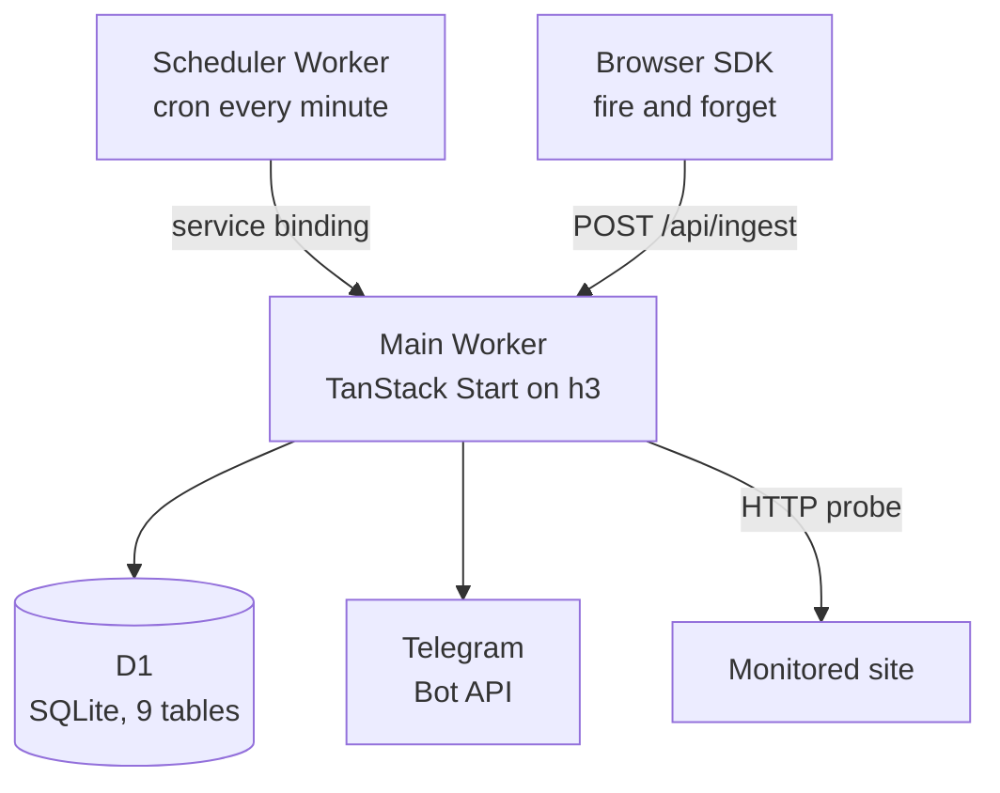

## Summary

WebWatch is a self-hosted uptime monitor and error tracker. It probes URLs on a schedule, records availability and response times, and opens an incident when a site fails repeatedly. A small browser SDK reports frontend and backend errors with stack traces to the same account. Both halves report to Telegram, and the login flow uses Telegram too, so nothing in the system stores a password.

## Context and constraints

Three constraints shaped the build:

- **Edge native.** Everything runs on Cloudflare Workers with D1. No long-lived server, no connection pool, no external queue.
- **No passwords.** A user proves they own an email address by proving control of a Telegram chat, because the login code is delivered in that chat and never leaves it.
- **Small footprint.** The SDK is a single ES module served from the deployment itself. It never blocks the host application: every request it makes is fire-and-forget and failures are swallowed.

Two problems sit side by side, and they have different shapes. Uptime monitoring is outbound, the platform probes your URL. APM is inbound, your app reports errors to the platform. One account covers both, but the two paths share no code.

## Architecture

The main worker holds the SSR pages, the API route handlers, the monitoring engine, the Telegram webhook, and the ingestion endpoint. A second, framework-free worker exists only to fire the cron. It calls the main worker over a service binding, so no public DNS or egress path is involved.

The scheduler has to be separate because of the build preset. The main worker is built with Nitro's `cloudflare-module` preset, and that preset swallows the `scheduled` event: the framework handler receives it and the application's own `export default { scheduled }` never fires. A cron trigger attached to the main worker runs no application code at all. Putting the trigger on a plain Worker sidesteps the framework entirely.

## Features

**Synthetic uptime monitoring.** Per-site interval from 1 to 1440 minutes. A site turns down only after N consecutive failures, where N runs from 1 to 100, and a single success resets the counter. An optional keyword assertion catches the case where a site answers 200 with a broken page. An optional SSL check warns when a certificate has 7 days or less left, at most once every 24 hours. Incidents open on the first confirmed failure and close on recovery with the exact downtime recorded. Probes time out after 10 seconds and the SSL handshake after 5. Up to 200 sites are processed per tick in parallel batches of 15, and checks plus resolved incidents older than 30 days are purged daily.

**APM ingestion.** `POST /api/ingest` takes a Bearer key and a batch of events. Each event carries type, message, stack trace, URL, method, and environment. Rows go in through D1 `batch()` in chunks of 50, and the first error in a batch produces one Telegram alert while the rest are recorded silently.

**Passwordless login.** The first sign-in returns a Telegram deep link, and the bot consumes the token to link the chat. Later sign-ins get a 6-digit code. Codes expire after 5 minutes, work once, and lock after 5 failed attempts. Sessions last 30 days in an HttpOnly, Secure, SameSite=Lax cookie, and only the SHA-256 hash of the token is stored.

**Telegram as the interface.** The bot handles `/addsite`, `/status`, `/pause`, `/resume`, `/history`, and `/removesite`, and the same chat receives the downtime, recovery, and SSL alerts. A 10-minute cooldown between repeated down and recovered notifications keeps a flapping site from flooding the chat.

**Domain verification.** Before APM telemetry is accepted for a site, the platform fetches `webwatch-verify.txt` from that site's web root and checks it against a per-site token. Without that step anyone could attach a domain they do not own and spend the quota on someone else's traffic. Uptime monitoring is not gated on it.

**Dashboard.** Five authenticated routes: an overview with stat cards, a site grid for create and configure, a site detail page with 30-day uptime and response-time charts, an APM event stream, and incident history.

**SDK.** One ES module served from `/api/public/sdk` on the deployment itself, so no npm install and no third-party CDN. It hooks `window.onerror` and `window.onunhandledrejection`, and ships an Express middleware for backend errors. Every call is fire-and-forget with failures swallowed, so monitoring can never take down the app it monitors.

## Design decisions

**The state machine is a pure function.** The rules for when a site goes down live in `monitor-core.ts` with no I/O. Everything around it, probing, inserting rows, sending messages, is orchestration. That split is what makes the transition table testable, including the cases behind most alert bugs: a site that has never been up does not emit a recovery message, and any success resets the failure counter.

**One secret guarded three surfaces, and that was a shortcut.** The Telegram webhook, the manual cron endpoint, and the scheduler all authenticate with the same shared secret, because the two workers have to agree on one value. One leaked secret therefore disables all three. Separate values on the main worker would fix it.

**Verification gates telemetry, not uptime.** Domain verification exists to stop telemetry attribution abuse, not to protect the platform from probing. Blocking uptime behind it would add a step for a problem the domain owner already controls.

**Status is inferred, not observed.** The platform cannot see the scheduler directly, so the public status page reads the newest check row and reports an outage when nothing has been recorded for 10 minutes. That produces a false alarm when no site happens to be due. A heartbeat row written by the scheduler would be the honest fix.

**Alerts fire on transitions, not on failures.** A site that keeps failing produces one incident and one notification, not one per probe. The cooldown covers the flapping case where a site bounces between up and down.

## Known gaps

- The ingestion endpoint has no rate limiting, so a single API key can insert rows without bound.
- APM events are never purged, so that table grows without limit.
- The SSRF guard reads the hostname string only and never resolves DNS, so a hostname pointing at a private address is not blocked.
- Expired session rows are not garbage collected.
- The npm package in the repository hardcodes a placeholder ingestion URL. The SDK served from `/api/public/sdk` is the working one.

## Status

Live and running on Cloudflare Workers, with D1 for storage and Telegram for alerts and login.
